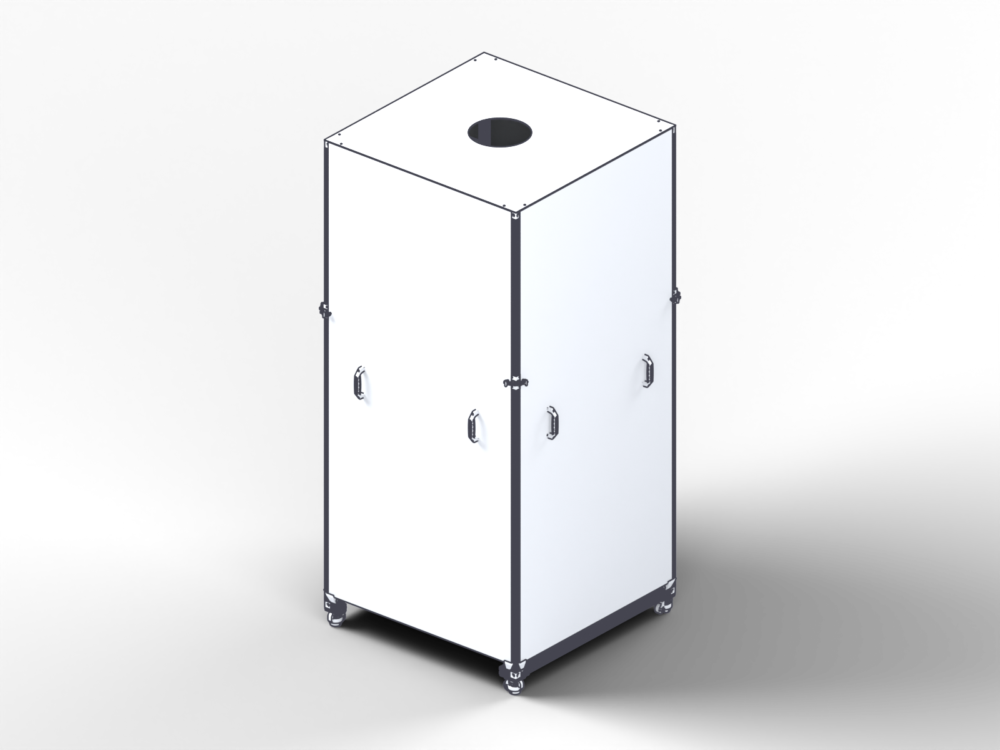

# Free Standing Tank Enclosure

<!-- Generated by assembly/site_pages.py from docs/manual/manual.json; do not edit. -->

Documentation for the modified free-standing enclosure designed by Sam Jager for the
Schulze lab at Janelia: a T-slot aluminium frame on casters with removable panels, a
camera frame with a spring-loaded roller mechanism, and, in the original design, tank
support frames with a light box. The modified build replaces the tanks and light box
with two monitors under acrylic and vacuum-formed bowls; that redesign comes after the
enclosure itself is assembled.

!!! warning "Draft documentation"

    Parts inventory and overview only: no assembly sequence has been authored or reviewed for this scene.

    Geometry and hierarchy come from the CAD export named in the build record. Quantities are CAD instance counts, not purchase quantities, kits, stock or an approved bill of materials.

    Project note: The tank(s) and the lower light box are to be replaced in the modified build by two Alienware AW2725Q monitors under an acrylic panel and bowl frames (Peter, 2026-10-22; intent, not a designer confirmation; the light-box occurrences are not yet identified). CAD counts are unchanged.

    Subassembly pages and joint close-ups are inspection views of parts at their CAD positions; they are not assembly steps and imply no sequence, fasteners or tool access.

    Supplementary items (20 rows, 16 for the existing design, 4 for new design in the appendix only) are hardware not modelled in CAD: listed separately for review, never added to CAD quantities, unknown quantities left unknown; not an approved bill of materials.

    CAD ambiguity: 1 pair(s) of occurrences of the same part share one position (SHULZE 2W.353 TANK). All source instances are kept and counted; review the intended configuration before treating the count as stock.

    Stock is unknown until counted and recorded (on_hand_each with counted_by and counted_date). The counted box is for a paper count only.

The finished assembly with its subassemblies numbered. On the site the picture is a model
that turns when the viewer data has been built, or the overview render; each number is a
link to the subassembly's page with its parts, the hardware still to review and its joint
close-ups.

<figure class="ov">
<svg class="callouts" viewBox="0 0 1600 1200" aria-label="Numbered callouts; each number is a link">
<a href="subassemblies/free-standing-frame/"><title>6: FREE STANDING FRAME (1 in the project)</title><rect x="518" y="85" width="564" height="1031"/><circle cx="544" cy="111" r="26"/><text x="544" y="111">6</text></a>
<a href="subassemblies/root-level-parts/"><title>7: Root-level parts (1 in the project)</title><rect x="519" y="84" width="562" height="738"/><circle cx="545" cy="110" r="26"/><text x="545" y="110">7</text></a>
<a href="subassemblies/panel-assembly/"><title>2: PANEL ASSEMBLY (4 in the project)</title><rect x="525" y="227" width="294" height="837"/><circle cx="551" cy="253" r="26"/><text x="551" y="253">2</text></a>
<a href="subassemblies/tank-support-frame/"><title>4: TANK SUPPORT FRAME (2 in the project)</title><rect x="533" y="586" width="534" height="272"/><circle cx="559" cy="612" r="26"/><text x="559" y="612">4</text></a>
<a href="subassemblies/camera-frame/"><title>5: CAMERA FRAME (1 in the project)</title><rect x="526" y="193" width="416" height="292"/><circle cx="552" cy="219" r="26"/><text x="552" y="219">5</text></a>
<a href="subassemblies/caster-assembly/"><title>1: CASTER ASSEMBLY (4 in the project)</title><rect x="753" y="832" width="47" height="45"/><circle cx="779" cy="858" r="26"/><text x="779" y="858">1</text></a>
<a href="subassemblies/toggle-clamp-assembly/"><title>3: TOGGLE CLAMP ASSEMBLY (4 in the project)</title><rect x="508" y="481" width="24" height="29"/><circle cx="534" cy="507" r="26"/><text x="534" y="507">3</text></a>
</svg>
<figcaption>The finished assembly, all parts at their CAD positions. The numbers are links.</figcaption></figure>

| # | Subassembly | In the project | Parts in one | Page |
| ---: | --- | ---: | ---: | --- |
| 1 | CASTER ASSEMBLY | 4 | 2 | [caster-assembly](subassemblies/caster-assembly.md) |
| 2 | PANEL ASSEMBLY | 4 | 3 | [panel-assembly](subassemblies/panel-assembly.md) |
| 3 | TOGGLE CLAMP ASSEMBLY | 4 | 3 | [toggle-clamp-assembly](subassemblies/toggle-clamp-assembly.md) |
| 4 | TANK SUPPORT FRAME | 2 | 22 | [tank-support-frame](subassemblies/tank-support-frame.md) |
| 5 | CAMERA FRAME | 1 | 36 | [camera-frame](subassemblies/camera-frame.md) |
| 6 | FREE STANDING FRAME | 1 | 49 | [free-standing-frame](subassemblies/free-standing-frame.md) |
| 7 | Root-level parts | 1 | 2 | [root-level-parts](subassemblies/root-level-parts.md) |

## Read

- [Parts](parts.md): every modelled part with its picture, size, CAD quantity and where it is used.
- [Joint close-ups](joints.md) and the [supplementary items](supplement.md) not modelled in CAD.
- The whole manual on one page: [manual/index.html](manual/index.html), with paper count boxes; for print [appendix PDF](manual/free-standing-enclosure-991056-inventory-appendix.pdf) · [compact PDF](manual/free-standing-enclosure-991056-inventory.pdf).
- [Phase 1 verification list](../assembly/procurement/phase-1-parts.csv): what to count
  before ordering, with the enclosure built first without tanks and backlight
  ([build scope](../assembly/build-scope.json)).
- [Stock and completeness audit](../assembly/procurement/README.md): modeled parts,
  candidate missing hardware, what the native Inventor BOM audit found.
- [Draft assembly order](../assembly/instructions.json): a modular proposal; the real
  order is recorded from the physical build.
- [Build record](record.md) and [how the documentation is built](../assembly/documentation-workflow.md)
  from the accepted CAD snapshot with the `mechanical-docs` pipeline.

## Source

- CAD: Vault root `Free Standing Enclosure.iam`, file-version 991056, exported as 37 STEP
  parts with 155 placements into [references/enclosure](../references/enclosure/README.md).
- Repository: [peterpolidoro/free-standing-tank-enclosure](https://github.com/peterpolidoro/free-standing-tank-enclosure).
