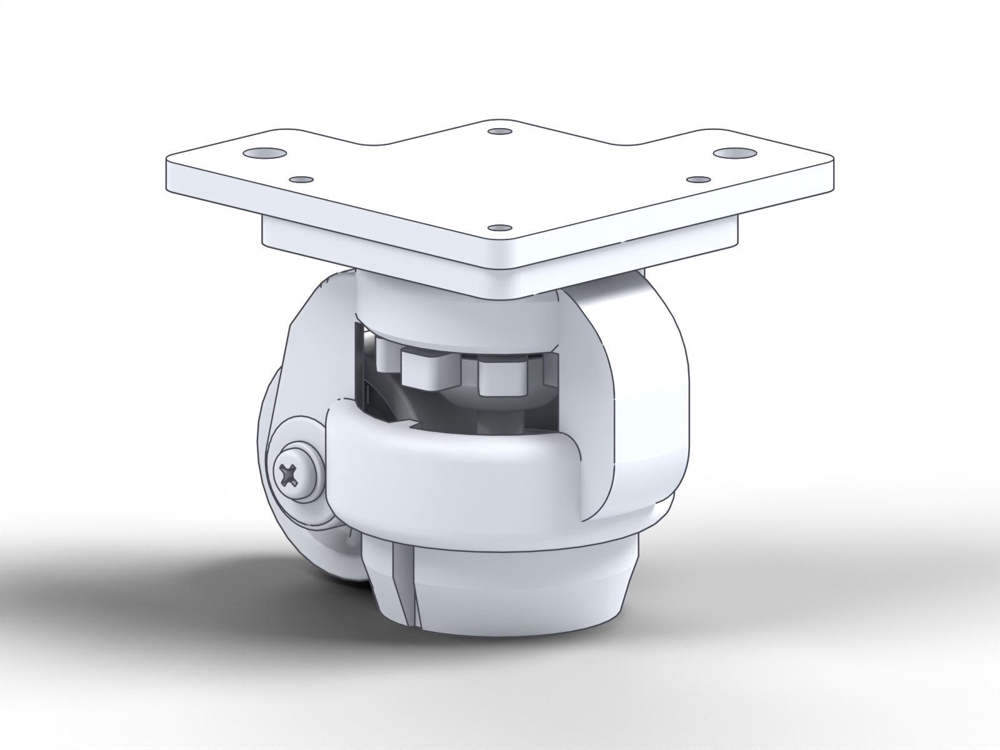
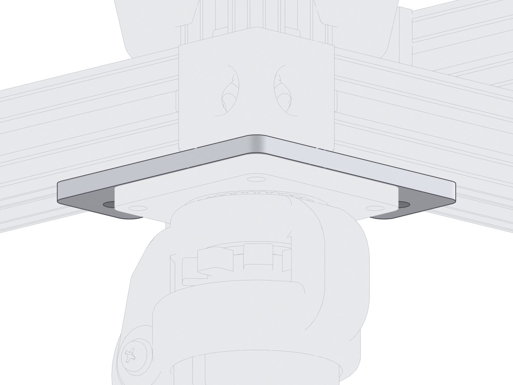
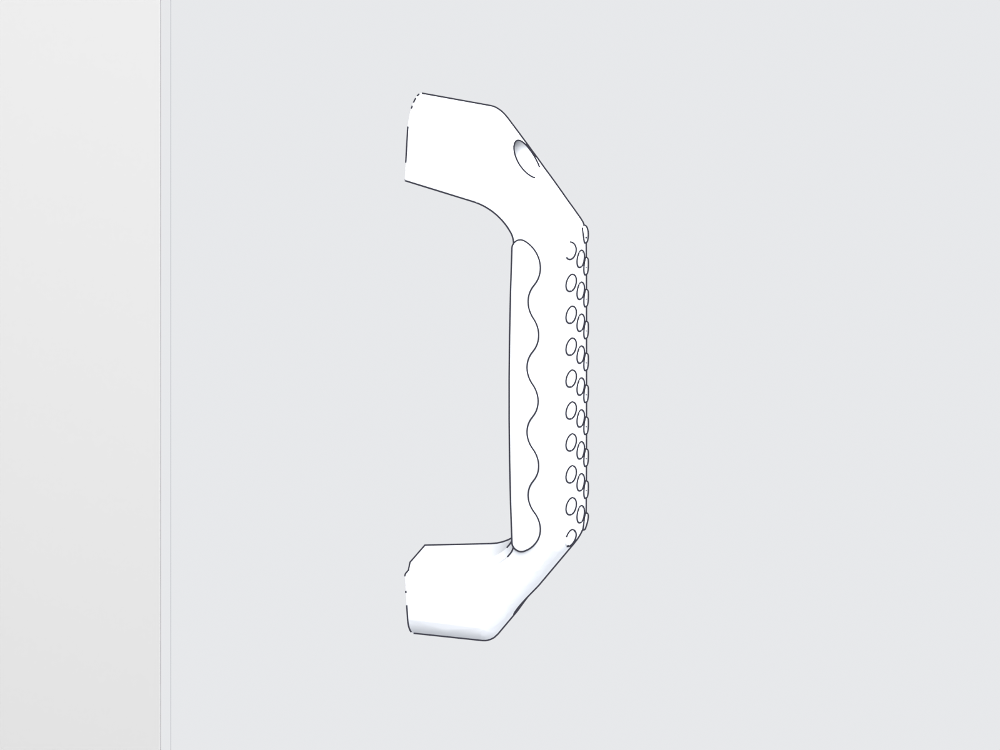
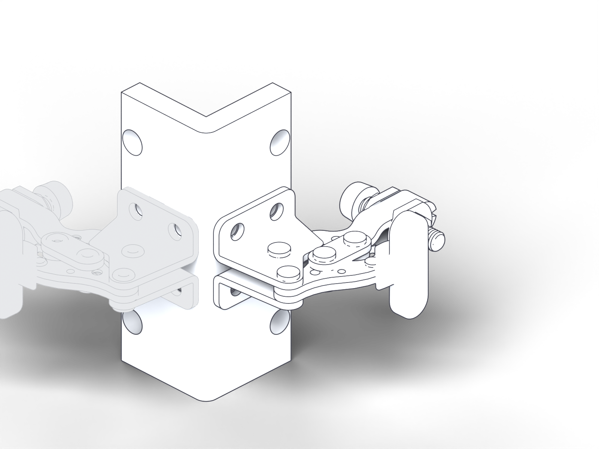
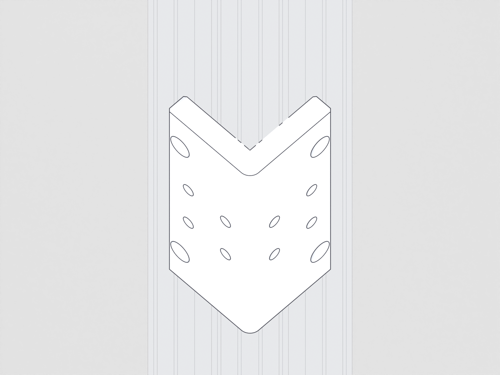
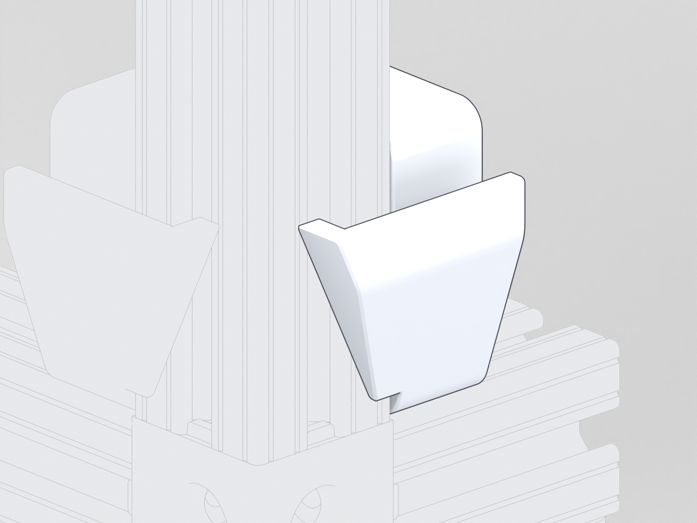
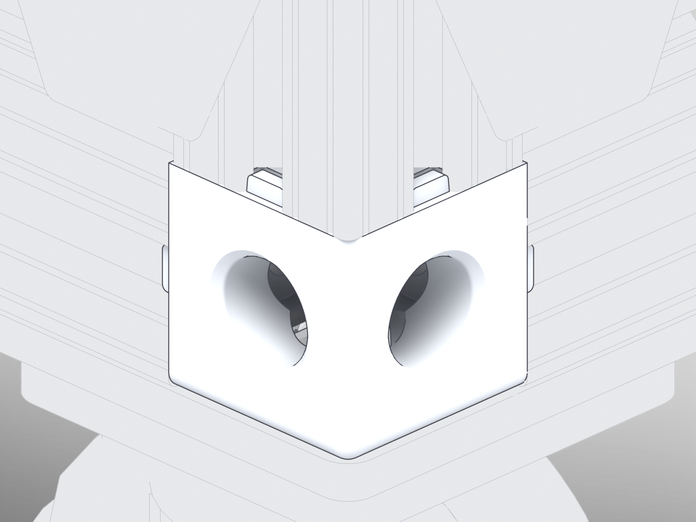
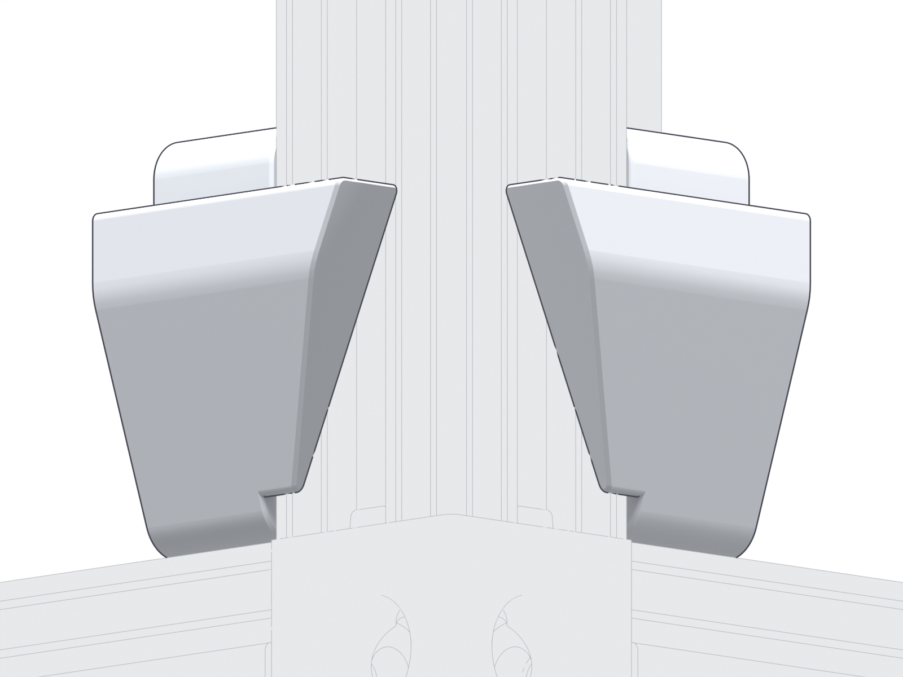

<!-- Generated by assembly/site_pages.py from docs/manual/manual.json; do not edit. -->
# Joint close-ups (inspection views)

!!! warning "Draft documentation"

    Inspection views and CAD instance counts, not assembly steps, stock or a purchase list; the full status is on the [front page](index.md) and the [build record](record.md).

## Joint 1: caster_to_plate

inspection view, not a step: the joint&#x27;s occurrences at their CAD poses with the rest of the context subdued; no fastener, sequence or tool access implied. Context: FREE STANDING FRAME:1/CASTER ASSEMBLY:1. Parts: 27 HOLKIE LEVELING CASTER ×1, 28 CASTER MOUNTING PLATE ×1.

**Hardware to review at this joint (not an approved BOM)**

- **S1** Caster-to-mounting-plate fastening: candidate, requires review; required unknown (family, not specified); basis: 4 caster assemblies; attachment points per caster unverified ([details](supplement.md#sup-001))

## Joint 2: caster_plate_to_frame

inspection view, not a step: the joint&#x27;s occurrences at their CAD poses with the rest of the context subdued; no fastener, sequence or tool access implied. Context: FREE STANDING FRAME:1. Parts: 28 CASTER MOUNTING PLATE ×1.

**Hardware to review at this joint (not an approved BOM)**

- **S2** Caster-plate-to-frame fastening: candidate, requires review; required unknown (family, not specified); basis: 4 plates; frame attachments per plate unverified ([details](supplement.md#sup-002))

## Joint 3: handle_to_panel

inspection view, not a step: the joint&#x27;s occurrences at their CAD poses with the rest of the context subdued; no fastener, sequence or tool access implied. Context: PANEL ASSEMBLY:1. Parts: 34 MCMASTER 1950A67 Unthreaded-Hole Pull Handle ×1.

**Hardware to review at this joint (not an approved BOM)**

- **S3** Pull-handle-to-panel fastening: candidate, requires review; required unknown (family, not specified); basis: 8 handles on 4 panels; fastening points per handle unverified ([details](supplement.md#sup-003))

## Joint 4: clamp_to_mount

inspection view, not a step: the joint&#x27;s occurrences at their CAD poses with the rest of the context subdued; no fastener, sequence or tool access implied. Context: TOGGLE CLAMP ASSEMBLY:1. Parts: 36 MCMASTER 5004A11 Compact Hold-Down Toggle Clamp ×1, 37 TOGGLE CLAMP MOUNT ×1.

**Hardware to review at this joint (not an approved BOM)**

- **S4** Toggle-clamp-to-mount fastening: candidate, requires review; required unknown (family, not specified); basis: 8 clamps on 4 mounts; points per clamp unverified ([details](supplement.md#sup-004))

## Joint 5: clamp_mount_to_frame

inspection view, not a step: the joint&#x27;s occurrences at their CAD poses with the rest of the context subdued; no fastener, sequence or tool access implied. Context: FREE STANDING FRAME:1. Parts: 37 TOGGLE CLAMP MOUNT ×1.

**Hardware to review at this joint (not an approved BOM)**

- **S5** Toggle-clamp-mount-to-frame fastening: candidate, requires review; required unknown (family, not specified); basis: 4 mounts; points per mount unverified ([details](supplement.md#sup-005))

## Joint 6: lower_support_to_frame

inspection view, not a step: the joint&#x27;s occurrences at their CAD poses with the rest of the context subdued; no fastener, sequence or tool access implied. Context: FREE STANDING FRAME:1. Parts: 31 PANEL LOWER SUPPORT LEFT ×1.

**Hardware to review at this joint (not an approved BOM)**

- **S6** Panel-lower-support fastening: candidate, requires review; required unknown (family, not specified); basis: 4 left + 4 right supports; points per support unverified ([details](supplement.md#sup-006))

## Joint 7: main_frame_joints

inspection view, not a step: the joint&#x27;s occurrences at their CAD poses with the rest of the context subdued; no fastener, sequence or tool access implied. Context: FREE STANDING FRAME:1. Parts: 25 MCMASTER 47065T245 ×1.

**Hardware to review at this joint (not an approved BOM)**

- **S7** Main-frame connector hardware and joint completeness: candidate, requires review; required unknown (family, not specified); basis: 11 long rails + 4 columns + 2 short rails; joint count requires review ([details](supplement.md#sup-007))

## Joint 8: camera_frame_joints

inspection view, not a step: the joint&#x27;s occurrences at their CAD poses with the rest of the context subdued; no fastener, sequence or tool access implied. Context: CAMERA FRAME:1. Parts: 9 MCMASTER 47065T845 Silver Corner Bracket ×1.

**Hardware to review at this joint (not an approved BOM)**

- **S8** Camera-frame connector and bracket hardware: candidate, requires review; required unknown (family, not specified); basis: 4 named 47065T845 brackets plus other connector/sliding parts ([details](supplement.md#sup-008))

## Joint 9: support_frame_corners

inspection view, not a step: the joint&#x27;s occurrences at their CAD poses with the rest of the context subdued; no fastener, sequence or tool access implied. Context: TANK SUPPORT FRAME:1. Parts: 18 T SLOT CORNER 47065T242 ×1.

**Hardware to review at this joint (not an approved BOM)**

- **S9** Tank-support-frame corner hardware: candidate, requires review; required unknown (family, not specified); basis: 8 modeled corner connectors across 2 support frames ([details](supplement.md#sup-009))

## Joint 10: support_brackets

inspection view, not a step: the joint&#x27;s occurrences at their CAD poses with the rest of the context subdued; no fastener, sequence or tool access implied. Context: TANK SUPPORT FRAME:1. Parts: 23 TANK SUPPORT BRACKET ×1.

**Hardware to review at this joint (not an approved BOM)**

- **S10** Tank-support-bracket attachment hardware: candidate, requires review; required unknown (family, not specified); basis: 8 brackets across 2 support frames ([details](supplement.md#sup-010))

## Joint 11: vibration_mounts

inspection view, not a step: the joint&#x27;s occurrences at their CAD poses with the rest of the context subdued; no fastener, sequence or tool access implied. Context: TANK SUPPORT FRAME:1. Parts: 19 MCMASTER 9378K24 Natural Rubber Vibration-Damping Sandwich Mount ×1, 20 MCMASTER 90313A107 18-8 Stainless Steel Oversized Washer ×1.

**Hardware to review at this joint (not an approved BOM)**

- **S11** Vibration-mount retention hardware: candidate, requires review; required unknown (family, not specified); basis: 8 mounts + 8 oversized washers modeled ([details](supplement.md#sup-011))

## Joint 12: camera_plates

inspection view, not a step: the joint&#x27;s occurrences at their CAD poses with the rest of the context subdued; no fastener, sequence or tool access implied. Context: CAMERA FRAME:1. Parts: 15 CAMERA MOUNT PLATE ×1, 16 CAMERA MOUNT PLATE - TELEDYNE KINETIX ×1.

**Hardware to review at this joint (not an approved BOM)**

- **S12** Camera, spring and roller plate attachment hardware: candidate, requires review; required unknown (family, not specified); basis: 2 roller plates + 2 spring plates + 2 different camera plates ([details](supplement.md#sup-012))

## Joint 13: spring_roller

inspection view, not a step: the joint&#x27;s occurrences at their CAD poses with the rest of the context subdued; no fastener, sequence or tool access implied. Context: CAMERA FRAME:1. Parts: 8 MCMASTER 9293K121 Constant-Force Spring ×1, 10 MCMASTER 5972K164 Ball Bearing ×2, 11 MCMASTER 90265A164 18-8 Stainless Steel Shoulder Screw ×1, 12 SPRING ROLLER ×1.

**Hardware to review at this joint (not an approved BOM)**

- **S13** Spring end and roller/bearing retention hardware: candidate, requires review; required unknown (family, not specified); basis: 2 springs + 2 rollers + 4 bearings + 2 shoulder screws modeled ([details](supplement.md#sup-013))

## Joint 14: camera_attachment

inspection view, not a step: the joint&#x27;s occurrences at their CAD poses with the rest of the context subdued; no fastener, sequence or tool access implied. Context: CAMERA FRAME:1. Parts: 15 CAMERA MOUNT PLATE ×1, 16 CAMERA MOUNT PLATE - TELEDYNE KINETIX ×1.

**Hardware to review at this joint (not an approved BOM)**

- **S14** Camera-to-mount attachment: candidate, requires review; required unknown (family, not specified); basis: Camera plate variants present; actual camera selection unconfirmed ([details](supplement.md#sup-014))

## Joint 15: top_panel

inspection view, not a step: the joint&#x27;s occurrences at their CAD poses with the rest of the context subdued; no fastener, sequence or tool access implied. Context: root. Parts: 35 ENCLOSURE TOP PANEL ×1.

**Hardware to review at this joint (not an approved BOM)**

- **S15** Top-panel retention and edge/support interface: candidate, requires review; required unknown (family, not specified); basis: 1 enclosure top panel ([details](supplement.md#sup-015))

## Joint 16: panel_retention

inspection view, not a step: the joint&#x27;s occurrences at their CAD poses with the rest of the context subdued; no fastener, sequence or tool access implied. Context: FREE STANDING FRAME:1. Parts: 31 PANEL LOWER SUPPORT LEFT ×1, 32 PANEL LOWER SUPPORT RIGHT ×1.

**Hardware to review at this joint (not an approved BOM)**

- **S16** Removable-panel retention interface: candidate, requires review; required unknown (family, not specified); basis: 4 panels, 8 lower supports, 8 toggle clamps ([details](supplement.md#sup-016))

