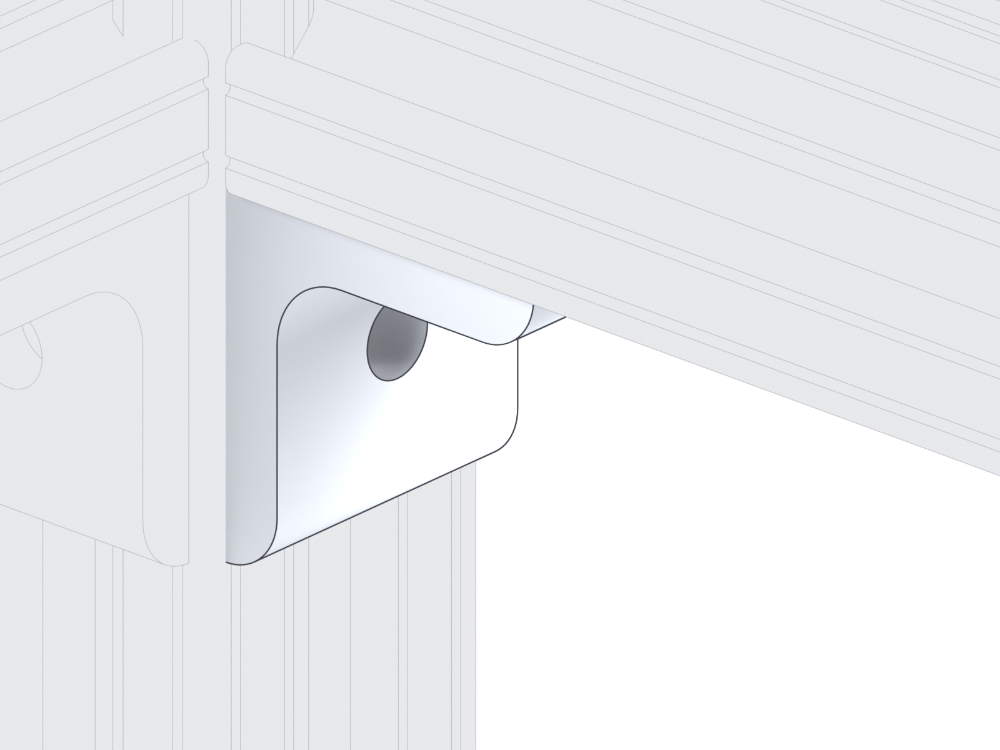
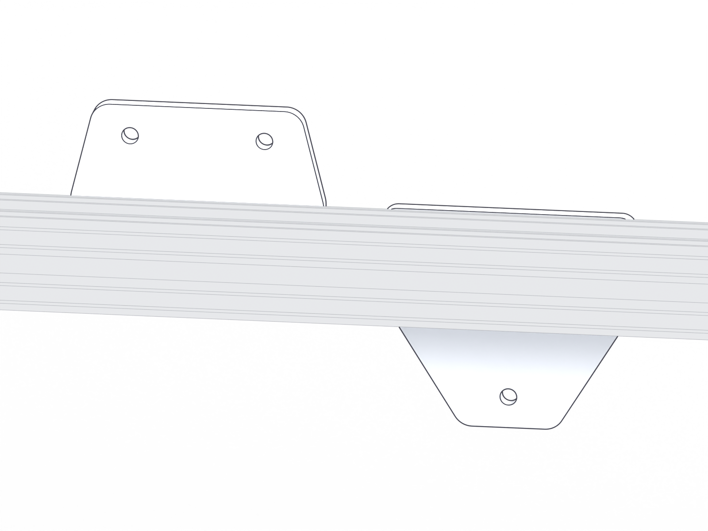
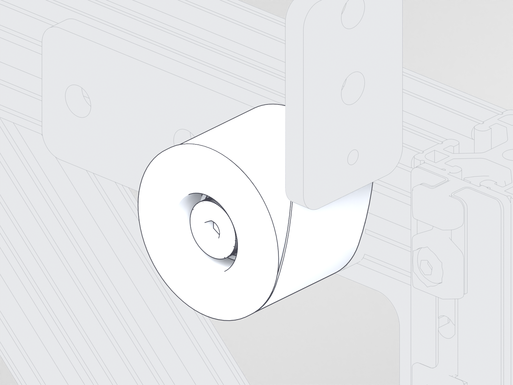
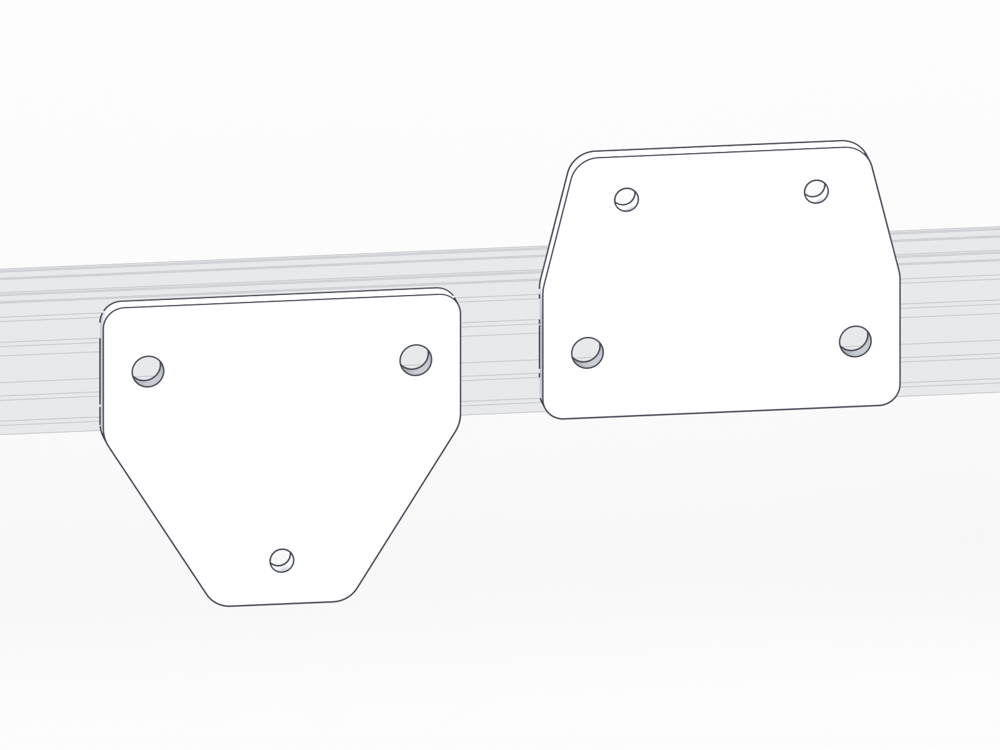

<!-- Generated by assembly/site_pages.py from docs/manual/manual.json; do not edit. -->
# Subassembly 5: CAMERA FRAME

**1 copy in the project**: `CAMERA FRAME:1`. The picture shows `CAMERA FRAME:1`.

!!! warning "Draft documentation"

    Inspection views and CAD instance counts, not assembly steps, stock or a purchase list; the full status is on the [front page](../index.md) and the [build record](../record.md).

<figure class="ov">
<svg class="callouts" viewBox="0 0 1600 1200" aria-label="Numbered callouts; each number is a link">
<a href="../../parts/#part-5"><title>5: SLLB Enclosure 41in 47065T808 T-Slotted Framing</title><rect x="548" y="144" width="882" height="376"/><circle cx="574" cy="170" r="26"/><text x="574" y="170">5</text></a>
<a href="../../parts/#part-5"><title>5: SLLB Enclosure 41in 47065T808 T-Slotted Framing</title><rect x="171" y="351" width="882" height="376"/><circle cx="197" cy="377" r="26"/><text x="197" y="377">5</text></a>
<a href="../../parts/#part-4"><title>4: SLLB Enclosure 22in 47065T808 T-Slotted Framing</title><rect x="166" y="128" width="418" height="260"/><circle cx="192" cy="154" r="26"/><text x="192" y="154">4</text></a>
<a href="../../parts/#part-4"><title>4: SLLB Enclosure 22in 47065T808 T-Slotted Framing</title><rect x="1054" y="465" width="418" height="260"/><circle cx="1080" cy="491" r="26"/><text x="1080" y="491">4</text></a>
<a href="../../parts/#part-7"><title>7: MCMASTER 47065T27 T-Slotted Framing</title><rect x="849" y="628" width="227" height="307"/><circle cx="875" cy="654" r="26"/><text x="875" y="654">7</text></a>
<a href="../../parts/#part-7"><title>7: MCMASTER 47065T27 T-Slotted Framing</title><rect x="147" y="278" width="199" height="316"/><circle cx="173" cy="304" r="26"/><text x="173" y="304">7</text></a>
<a href="../../parts/#part-7"><title>7: MCMASTER 47065T27 T-Slotted Framing</title><rect x="1036" y="616" width="199" height="316"/><circle cx="1062" cy="642" r="26"/><text x="1062" y="642">7</text></a>
<a href="../../parts/#part-7"><title>7: MCMASTER 47065T27 T-Slotted Framing</title><rect x="148" y="421" width="227" height="188"/><circle cx="174" cy="447" r="26"/><text x="174" y="447">7</text></a>
<a href="../../parts/#part-6"><title>6: MCMASTER 3136N149 T-Slotted Framing</title><rect x="1232" y="470" width="232" height="112"/><circle cx="1258" cy="496" r="26"/><text x="1258" y="496">6</text></a>
<a href="../../parts/#part-6"><title>6: MCMASTER 3136N149 T-Slotted Framing</title><rect x="438" y="169" width="232" height="112"/><circle cx="464" cy="195" r="26"/><text x="464" y="195">6</text></a>
<a href="../../parts/#part-3"><title>3: SLLB Enclosure 15in 47065T808 T-Slotted Framing</title><rect x="1028" y="676" width="58" height="392"/><circle cx="1054" cy="702" r="26"/><text x="1054" y="702">3</text></a>
<a href="../../parts/#part-3"><title>3: SLLB Enclosure 15in 47065T808 T-Slotted Framing</title><rect x="139" y="339" width="58" height="392"/><circle cx="165" cy="365" r="26"/><text x="165" y="365">3</text></a>
<a href="../../parts/#part-2"><title>2: MCMASTER 5537T429 T-Slotted Framing</title><rect x="993" y="930" width="104" height="142"/><circle cx="1019" cy="956" r="26"/><text x="1019" y="956">2</text></a>
<a href="../../parts/#part-2"><title>2: MCMASTER 5537T429 T-Slotted Framing</title><rect x="128" y="602" width="104" height="142"/><circle cx="154" cy="628" r="26"/><text x="154" y="628">2</text></a>
<a href="../../parts/#part-15"><title>15: CAMERA MOUNT PLATE</title><rect x="940" y="281" width="89" height="120"/><circle cx="966" cy="307" r="26"/><text x="966" y="307">15</text></a>
<a href="../../parts/#part-16"><title>16: CAMERA MOUNT PLATE - TELEDYNE KINETIX</title><rect x="836" y="205" width="89" height="108"/><circle cx="862" cy="231" r="26"/><text x="862" y="231">16</text></a>
<a href="../../parts/#part-13"><title>13: ROLLER MOUNT PLATE</title><rect x="1097" y="641" width="80" height="79"/><circle cx="1123" cy="667" r="26"/><text x="1123" y="667">13</text></a>
<a href="../../parts/#part-13"><title>13: ROLLER MOUNT PLATE</title><rect x="171" y="290" width="80" height="79"/><circle cx="197" cy="316" r="26"/><text x="197" y="316">13</text></a>
<a href="../../parts/#part-8"><title>8: MCMASTER 9293K121 Constant-Force Spring</title><rect x="138" y="288" width="63" height="87"/><circle cx="164" cy="314" r="26"/><text x="164" y="314">8</text></a>
<a href="../../parts/#part-8"><title>8: MCMASTER 9293K121 Constant-Force Spring</title><rect x="1096" y="652" width="63" height="87"/><circle cx="1122" cy="678" r="26"/><text x="1122" y="678">8</text></a>
<a href="../../parts/#part-12"><title>12: SPRING ROLLER</title><rect x="1092" y="665" width="75" height="71"/><circle cx="1118" cy="691" r="26"/><text x="1118" y="691">12</text></a>
<a href="../../parts/#part-12"><title>12: SPRING ROLLER</title><rect x="139" y="299" width="62" height="75"/><circle cx="165" cy="325" r="26"/><text x="165" y="325">12</text></a>
<a href="../../parts/#part-1"><title>1: MCMASTER 5537T293 T-Slotted Framing</title><rect x="1051" y="685" width="45" height="98"/><circle cx="1077" cy="711" r="26"/><text x="1077" y="711">1</text></a>
<a href="../../parts/#part-1"><title>1: MCMASTER 5537T293 T-Slotted Framing</title><rect x="129" y="335" width="45" height="98"/><circle cx="155" cy="361" r="26"/><text x="155" y="361">1</text></a>
<a href="../../parts/#part-9"><title>9: MCMASTER 47065T845 Silver Corner Bracket</title><rect x="998" y="702" width="55" height="61"/><circle cx="1024" cy="728" r="26"/><text x="1024" y="728">9</text></a>
<a href="../../parts/#part-9"><title>9: MCMASTER 47065T845 Silver Corner Bracket</title><rect x="172" y="388" width="55" height="61"/><circle cx="198" cy="414" r="26"/><text x="198" y="414">9</text></a>
<a href="../../parts/#part-9"><title>9: MCMASTER 47065T845 Silver Corner Bracket</title><rect x="1056" y="699" width="54" height="61"/><circle cx="1082" cy="725" r="26"/><text x="1082" y="725">9</text></a>
<a href="../../parts/#part-9"><title>9: MCMASTER 47065T845 Silver Corner Bracket</title><rect x="168" y="362" width="54" height="62"/><circle cx="194" cy="388" r="26"/><text x="194" y="388">9</text></a>
<a href="../../parts/#part-14"><title>14: SPRING MOUNT PLATE</title><rect x="131" y="267" width="36" height="72"/><circle cx="157" cy="293" r="26"/><text x="157" y="293">14</text></a>
<a href="../../parts/#part-14"><title>14: SPRING MOUNT PLATE</title><rect x="1088" y="631" width="36" height="72"/><circle cx="1114" cy="657" r="26"/><text x="1114" y="657">14</text></a>
<a href="../../parts/#part-11"><title>11: MCMASTER 90265A164 18-8 Stainless Steel Shoulder Screw</title><rect x="1097" y="681" width="53" height="34"/><circle cx="1123" cy="707" r="26"/><text x="1123" y="707">11</text></a>
<a href="../../parts/#part-11"><title>11: MCMASTER 90265A164 18-8 Stainless Steel Shoulder Screw</title><rect x="152" y="321" width="48" height="36"/><circle cx="178" cy="347" r="26"/><text x="178" y="347">11</text></a>
<a href="../../parts/#part-10"><title>10: MCMASTER 5972K164 Ball Bearing</title><rect x="1120" y="687" width="26" height="30"/><circle cx="1146" cy="713" r="26"/><text x="1146" y="713">10</text></a>
<a href="../../parts/#part-10"><title>10: MCMASTER 5972K164 Ball Bearing</title><rect x="1105" y="682" width="26" height="29"/><circle cx="1131" cy="708" r="26"/><text x="1131" y="708">10</text></a>
<a href="../../parts/#part-10"><title>10: MCMASTER 5972K164 Ball Bearing</title><rect x="172" y="325" width="20" height="31"/><circle cx="198" cy="351" r="26"/><text x="198" y="351">10</text></a>
<a href="../../parts/#part-10"><title>10: MCMASTER 5972K164 Ball Bearing</title><rect x="156" y="319" width="20" height="31"/><circle cx="182" cy="345" r="26"/><text x="182" y="345">10</text></a>
</svg>
<figcaption>CAMERA FRAME: inspection view: occurrences at their CAD poses; not an assembly step; no sequence, fasteners or tool access implied. The numbers are links.</figcaption></figure>

## Parts

| # | Picture | Part | Per subassembly | Total |
| ---: | --- | --- | ---: | ---: |
| 1 |  | [MCMASTER 5537T293 T-Slotted Framing](../parts.md#part-1) <small>overall 80 × 32 × 28.4 mm</small> | 2 | 2 |
| 2 |  | [MCMASTER 5537T429 T-Slotted Framing](../parts.md#part-2) <small>overall 103 × 99.2 × 32 mm</small> | 2 | 2 |
| 3 |  | [SLLB Enclosure 15in 47065T808 T-Slotted Framing](../parts.md#part-3) <small>overall 381 × 38.1 × 38.1 mm</small> | 2 | 2 |
| 4 |  | [SLLB Enclosure 22in 47065T808 T-Slotted Framing](../parts.md#part-4) <small>overall 559 × 38.1 × 38.1 mm</small> | 2 | 2 |
| 5 |  | [SLLB Enclosure 41in 47065T808 T-Slotted Framing](../parts.md#part-5) <small>overall 1032 × 38.1 × 38.1 mm</small> | 2 | 2 |
| 6 |  | [MCMASTER 3136N149 T-Slotted Framing](../parts.md#part-6) <small>overall 152 × 152 × 6.3 mm</small> | 2 | 2 |
| 7 |  | [MCMASTER 47065T27 T-Slotted Framing](../parts.md#part-7) <small>overall 305 × 38.1 × 38.1 mm</small> | 4 | 4 |
| 8 |  | [MCMASTER 9293K121 Constant-Force Spring](../parts.md#part-8) <small>overall 59.9 × 52.6 × 31.8 mm</small> | 2 | 2 |
| 9 |  | [MCMASTER 47065T845 Silver Corner Bracket](../parts.md#part-9) <small>overall 38.1 × 38.1 × 33.3 mm</small> | 4 | 4 |
| 10 |  | [MCMASTER 5972K164 Ball Bearing](../parts.md#part-10) <small>overall 22 × 22 × 6 mm</small> | 4 | 4 |
| 11 |  | [MCMASTER 90265A164 18-8 Stainless Steel Shoulder Screw](../parts.md#part-11) <small>overall 45.3 × 16 × 16 mm</small> | 2 | 2 |
| 12 |  | [SPRING ROLLER](../parts.md#part-12) <small>overall 48 × 48 × 34.3 mm (1.89 × 1.89 × 1.35 in)</small> | 2 | 2 |
| 13 |  | [ROLLER MOUNT PLATE](../parts.md#part-13) <small>overall 108 × 38.1 × 6.3 mm (4.25 × 1.5 × 0.25 in)</small> | 2 | 2 |
| 14 |  | [SPRING MOUNT PLATE](../parts.md#part-14) <small>overall 60 × 38.1 × 6.3 mm (2.362 × 1.5 × 0.25 in)</small> | 2 | 2 |
| 15 |  | [CAMERA MOUNT PLATE](../parts.md#part-15) <small>overall 102 × 88.9 × 6.3 mm (4 × 3.5 × 0.25 in)</small> | 1 | 1 |
| 16 |  | [CAMERA MOUNT PLATE - TELEDYNE KINETIX](../parts.md#part-16) <small>overall 102 × 76.2 × 6.3 mm (4 × 3 × 0.25 in)</small> | 1 | 1 |

CAD quantities are instance counts in the model, not stock and not a purchase list.

## Hardware to review at this subassembly (not an approved BOM)

- **S8** Camera-frame connector and bracket hardware: candidate, requires review; required unknown (family, not specified); basis: 4 named 47065T845 brackets plus other connector/sliding parts; joint `camera_frame_joints` ([supplementary items](../supplement.md#sup-008))
- **S12** Camera, spring and roller plate attachment hardware: candidate, requires review; required unknown (family, not specified); basis: 2 roller plates + 2 spring plates + 2 different camera plates; joint `camera_plates` ([supplementary items](../supplement.md#sup-012))
- **S13** Spring end and roller/bearing retention hardware: candidate, requires review; required unknown (family, not specified); basis: 2 springs + 2 rollers + 4 bearings + 2 shoulder screws modeled; joint `spring_roller` ([supplementary items](../supplement.md#sup-013))
- **S14** Camera-to-mount attachment: candidate, requires review; required unknown (family, not specified); basis: Camera plate variants present; actual camera selection unconfirmed; joint `camera_attachment` ([supplementary items](../supplement.md#sup-014))

## Joint close-ups

### Joint 8: camera_frame_joints

Occurrences at their CAD poses; context CAMERA FRAME:1. Parts: 9 MCMASTER 47065T845 Silver Corner Bracket ×1.
- **S8** Camera-frame connector and bracket hardware: required unknown (family, not specified); basis: 4 named 47065T845 brackets plus other connector/sliding parts

### Joint 12: camera_plates

Occurrences at their CAD poses; context CAMERA FRAME:1. Parts: 15 CAMERA MOUNT PLATE ×1, 16 CAMERA MOUNT PLATE - TELEDYNE KINETIX ×1.
- **S12** Camera, spring and roller plate attachment hardware: required unknown (family, not specified); basis: 2 roller plates + 2 spring plates + 2 different camera plates

### Joint 13: spring_roller

Occurrences at their CAD poses; context CAMERA FRAME:1. Parts: 8 MCMASTER 9293K121 Constant-Force Spring ×1, 10 MCMASTER 5972K164 Ball Bearing ×2, 11 MCMASTER 90265A164 18-8 Stainless Steel Shoulder Screw ×1, 12 SPRING ROLLER ×1.
- **S13** Spring end and roller/bearing retention hardware: required unknown (family, not specified); basis: 2 springs + 2 rollers + 4 bearings + 2 shoulder screws modeled

### Joint 14: camera_attachment

Occurrences at their CAD poses; context CAMERA FRAME:1. Parts: 15 CAMERA MOUNT PLATE ×1, 16 CAMERA MOUNT PLATE - TELEDYNE KINETIX ×1.
- **S14** Camera-to-mount attachment: required unknown (family, not specified); basis: Camera plate variants present; actual camera selection unconfirmed

[All joints](../joints.md) · [All parts](../parts.md) · [Front page](../index.md)
