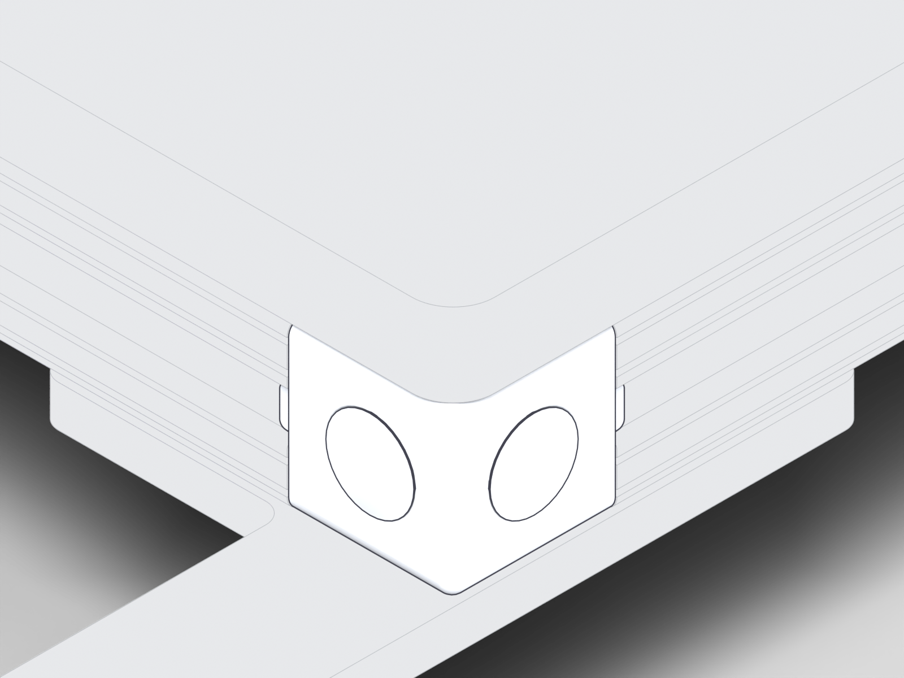
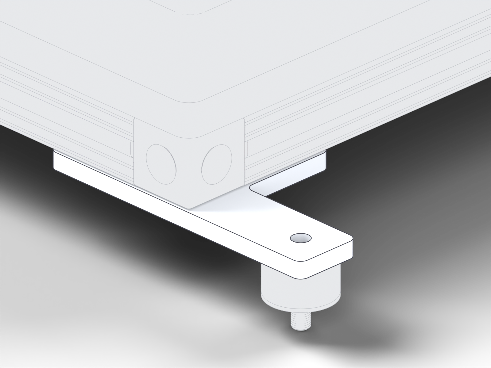
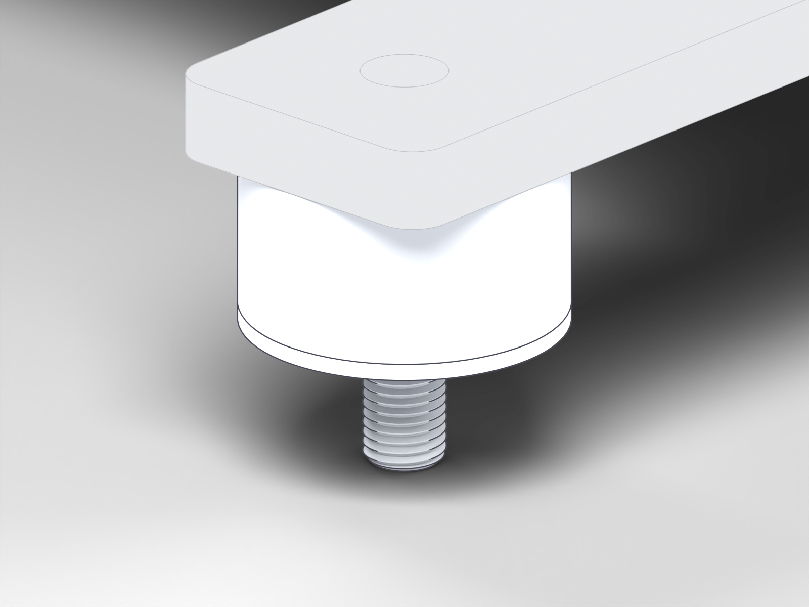

<!-- Generated by assembly/site_pages.py from docs/manual/manual.json; do not edit. -->
# Subassembly 4: TANK SUPPORT FRAME

**2 copies in the project**: `TANK SUPPORT FRAME:1`, `TANK SUPPORT FRAME:2`. The picture shows `TANK SUPPORT FRAME:1`.

!!! warning "Draft documentation"

    Inspection views and CAD instance counts, not assembly steps, stock or a purchase list; the full status is on the [front page](../index.md) and the [build record](../record.md).

<figure class="ov">
<svg class="callouts" viewBox="0 0 1600 1200" aria-label="Numbered callouts; each number is a link">
<a href="../../parts/#part-21"><title>21: TANK SUPPORT PLATFORM</title><rect x="261" y="104" width="1079" height="961"/><circle cx="287" cy="130" r="26"/><text x="287" y="130">21</text></a>
<a href="../../parts/#part-37"><title>37: SHULZE 2W.353 TANK</title><rect x="305" y="116" width="990" height="905"/><circle cx="331" cy="142" r="26"/><text x="331" y="142">37</text></a>
<a href="../../parts/#part-17"><title>17: TSLOT EXTRUSION 1X40.5 copy</title><rect x="753" y="118" width="572" height="435"/><circle cx="779" cy="144" r="26"/><text x="779" y="144">17</text></a>
<a href="../../parts/#part-17"><title>17: TSLOT EXTRUSION 1X40.5 copy</title><rect x="274" y="628" width="572" height="435"/><circle cx="300" cy="654" r="26"/><text x="300" y="654">17</text></a>
<a href="../../parts/#part-17"><title>17: TSLOT EXTRUSION 1X40.5 copy</title><rect x="847" y="545" width="481" height="516"/><circle cx="873" cy="571" r="26"/><text x="873" y="571">17</text></a>
<a href="../../parts/#part-17"><title>17: TSLOT EXTRUSION 1X40.5 copy</title><rect x="272" y="120" width="481" height="516"/><circle cx="298" cy="146" r="26"/><text x="298" y="146">17</text></a>
<a href="../../parts/#part-22"><title>22: TANK SUPPORT BRACKET</title><rect x="814" y="1017" width="91" height="79"/><circle cx="840" cy="1043" r="26"/><text x="840" y="1043">22</text></a>
<a href="../../parts/#part-22"><title>22: TANK SUPPORT BRACKET</title><rect x="1276" y="526" width="91" height="79"/><circle cx="1302" cy="552" r="26"/><text x="1302" y="552">22</text></a>
<a href="../../parts/#part-22"><title>22: TANK SUPPORT BRACKET</title><rect x="694" y="96" width="91" height="79"/><circle cx="720" cy="122" r="26"/><text x="720" y="122">22</text></a>
<a href="../../parts/#part-22"><title>22: TANK SUPPORT BRACKET</title><rect x="233" y="587" width="91" height="79"/><circle cx="259" cy="613" r="26"/><text x="259" y="613">22</text></a>
<a href="../../parts/#part-18"><title>18: T SLOT CORNER 47065T242</title><rect x="823" y="1023" width="47" height="50"/><circle cx="849" cy="1049" r="26"/><text x="849" y="1049">18</text></a>
<a href="../../parts/#part-18"><title>18: T SLOT CORNER 47065T242</title><rect x="1293" y="524" width="47" height="50"/><circle cx="1319" cy="550" r="26"/><text x="1319" y="550">18</text></a>
<a href="../../parts/#part-18"><title>18: T SLOT CORNER 47065T242</title><rect x="730" y="108" width="47" height="50"/><circle cx="756" cy="134" r="26"/><text x="756" y="134">18</text></a>
<a href="../../parts/#part-18"><title>18: T SLOT CORNER 47065T242</title><rect x="260" y="607" width="47" height="50"/><circle cx="286" cy="633" r="26"/><text x="286" y="633">18</text></a>
<a href="../../parts/#part-19"><title>19: MCMASTER 9378K24 Natural Rubber Vibration-Damping Sandwich Mount</title><rect x="1342" y="564" width="25" height="31"/><circle cx="1368" cy="590" r="26"/><text x="1368" y="590">19</text></a>
<a href="../../parts/#part-19"><title>19: MCMASTER 9378K24 Natural Rubber Vibration-Damping Sandwich Mount</title><rect x="233" y="608" width="25" height="31"/><circle cx="259" cy="634" r="26"/><text x="259" y="634">19</text></a>
<a href="../../parts/#part-19"><title>19: MCMASTER 9378K24 Natural Rubber Vibration-Damping Sandwich Mount</title><rect x="712" y="98" width="25" height="31"/><circle cx="738" cy="124" r="26"/><text x="738" y="124">19</text></a>
<a href="../../parts/#part-19"><title>19: MCMASTER 9378K24 Natural Rubber Vibration-Damping Sandwich Mount</title><rect x="863" y="1073" width="25" height="31"/><circle cx="889" cy="1099" r="26"/><text x="889" y="1099">19</text></a>
<a href="../../parts/#part-20"><title>20: MCMASTER 90313A107 18-8 Stainless Steel Oversized Washer</title><rect x="863" y="1077" width="25" height="23"/><circle cx="889" cy="1103" r="26"/><text x="889" y="1103">20</text></a>
<a href="../../parts/#part-20"><title>20: MCMASTER 90313A107 18-8 Stainless Steel Oversized Washer</title><rect x="712" y="102" width="25" height="23"/><circle cx="738" cy="128" r="26"/><text x="738" y="128">20</text></a>
<a href="../../parts/#part-20"><title>20: MCMASTER 90313A107 18-8 Stainless Steel Oversized Washer</title><rect x="1342" y="568" width="25" height="23"/><circle cx="1368" cy="594" r="26"/><text x="1368" y="594">20</text></a>
<a href="../../parts/#part-20"><title>20: MCMASTER 90313A107 18-8 Stainless Steel Oversized Washer</title><rect x="233" y="612" width="25" height="23"/><circle cx="259" cy="638" r="26"/><text x="259" y="638">20</text></a>
</svg>
<figcaption>TANK SUPPORT FRAME: inspection view: occurrences at their CAD poses; not an assembly step; no sequence, fasteners or tool access implied. The numbers are links.</figcaption></figure>

## Parts

| # | Picture | Part | Per subassembly | For all 2 |
| ---: | --- | --- | ---: | ---: |
| 17 |  | [TSLOT EXTRUSION 1X40.5 copy](../parts.md#part-17) <small>overall 1029 × 25.4 × 25.4 mm (40.5 × 1 × 1 in)</small> | 4 | 8 |
| 18 |  | [T SLOT CORNER 47065T242](../parts.md#part-18) <small>overall 47.4 × 47.4 × 25.2 mm (1.868 × 1.868 × 0.992 in)</small> | 4 | 8 |
| 19 |  | [MCMASTER 9378K24 Natural Rubber Vibration-Damping Sandwich Mount](../parts.md#part-19) <small>overall 25.7 × 25.4 × 25.4 mm (1.013 × 1 × 1 in)</small> | 4 | 8 |
| 20 |  | [MCMASTER 90313A107 18-8 Stainless Steel Oversized Washer](../parts.md#part-20) <small>overall 25.4 × 25.4 × 1.3 mm (1 × 1 × 0.05 in)</small> | 4 | 8 |
| 21 |  | [TANK SUPPORT PLATFORM](../parts.md#part-21) <small>overall 1080 × 1080 × 12.7 mm (42.5 × 42.5 × 0.5 in)</small> | 1 | 2 |
| 22 |  | [TANK SUPPORT BRACKET](../parts.md#part-22) <small>overall 114 × 63.5 × 6.3 mm (4.5 × 2.5 × 0.25 in)</small> | 4 | 8 |
| 37 |  | [SHULZE 2W.353 TANK](../parts.md#part-37) <small>overall 991 × 991 × 82.6 mm (39 × 39 × 3.25 in)</small> | 1 | 2 |

CAD quantities are instance counts in the model, not stock and not a purchase list.

## Hardware to review at this subassembly (not an approved BOM)

- **S9** Tank-support-frame corner hardware: candidate, requires review; required unknown (family, not specified); basis: 8 modeled corner connectors across 2 support frames; joint `support_frame_corners` ([supplementary items](../supplement.md#sup-009))
- **S10** Tank-support-bracket attachment hardware: candidate, requires review; required unknown (family, not specified); basis: 8 brackets across 2 support frames; joint `support_brackets` ([supplementary items](../supplement.md#sup-010))
- **S11** Vibration-mount retention hardware: candidate, requires review; required unknown (family, not specified); basis: 8 mounts + 8 oversized washers modeled; joint `vibration_mounts` ([supplementary items](../supplement.md#sup-011))

## Joint close-ups

### Joint 9: support_frame_corners

Occurrences at their CAD poses; context TANK SUPPORT FRAME:1. Parts: 18 T SLOT CORNER 47065T242 ×1.
- **S9** Tank-support-frame corner hardware: required unknown (family, not specified); basis: 8 modeled corner connectors across 2 support frames

### Joint 10: support_brackets

Occurrences at their CAD poses; context TANK SUPPORT FRAME:1. Parts: 22 TANK SUPPORT BRACKET ×1.
- **S10** Tank-support-bracket attachment hardware: required unknown (family, not specified); basis: 8 brackets across 2 support frames

### Joint 11: vibration_mounts

Occurrences at their CAD poses; context TANK SUPPORT FRAME:1. Parts: 19 MCMASTER 9378K24 Natural Rubber Vibration-Damping Sandwich Mount ×1, 20 MCMASTER 90313A107 18-8 Stainless Steel Oversized Washer ×1.
- **S11** Vibration-mount retention hardware: required unknown (family, not specified); basis: 8 mounts + 8 oversized washers modeled

[All joints](../joints.md) · [All parts](../parts.md) · [Front page](../index.md)
